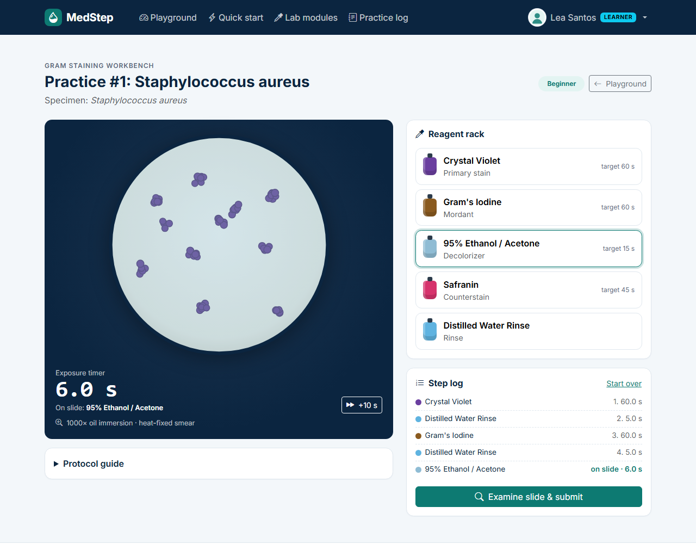

# MedStep

**MedStep** is a full-stack web laboratory simulator that gives allied health
students a zero-cost way to practice high-stakes microbiology protocols —
**Gram Staining** and **Quadrant Streak Plating** — outside the campus lab.
Learners manipulate virtual reagents, control exposure timers and review the
microscopic outcome of their own technique to build procedural muscle memory.

| | |
|---|---|
| **Framework** | Django 5.2 (backend + server-rendered templates) |
| **Frontend** | Bootstrap 5.3, Bootstrap Icons, SVG + vanilla JavaScript (no build step) |
| **Database** | Supabase PostgreSQL (via `psycopg` 3) |
| **Roles** | `learner` (Student Learner) and `admin` (Lab Admin / Content Curator) |

| Phase | Scope |
|---|---|
| **Phase 1 (PD1)** | Accounts: registration, login/logout, roles, role-based dashboards, profiles |
| **Phase 2 (PD2)** | Gram Staining Simulator: scenario catalog CRUD, interactive workbench, server-side grading, learner practice records |

The PD2 completion report is in [docs/PD2_Completion_Report.md](docs/PD2_Completion_Report.md).



---

## Features

### Phase 2 — Gram Staining Simulator (`simulator` app)

**Scenario catalog (Lab Admin CRUD).** Lab Admins create, list, edit, hide and
delete `GramStainScenario` modules at `/simulator/scenarios/`: specimen, Gram
reaction, cell shape (cocci / bacilli), difficulty and the target exposure time
for each reagent. Three starter specimens are seeded by a migration:
*Staphylococcus aureus*, *Escherichia coli* and an "Unknown Clinical Smear"
(*Bacillus cereus*). A scenario that already has learner attempts cannot be
deleted (database `PROTECT`); it can be hidden instead.

**Interactive workbench.** `/simulator/workbench/<id>/` shows a heat-fixed smear
under the microscope (SVG cocci clusters or bacilli rods) and a reagent rack:
Crystal Violet, Gram's Iodine, 95% Ethanol / Acetone, Safranin and a Distilled
Water Rinse. A reagent stays on the slide — with a live exposure timer and a
**+10 s fast-forward** button — until it is rinsed or replaced. Cells change
colour in real time: watch *E. coli* clear during decolorizing, or
*S. aureus* lose its violet if the decolorizer is held too long.

**Server-side grading.** On submit, the browser sends only the reagent sequence
and seconds held. [simulator/grading.py](simulator/grading.py) replays the
chemistry on the specimen's cell wall, scores the run (0–100), names the
outcome — e.g. *"Accurate Stain: Gram-Positive Cocci (Violet)"* or
*"Procedural Error: Over-decolorized (False Gram-Negative)"* — and saves a
`SimulationAttempt` to PostgreSQL. Score and diagnosis are never accepted from
the browser.

**Microscopic outcome report.** The learner's slide at high magnification next
to a correctly stained reference, step-by-step feedback against each target
time, the recorded steps, and editable lab notes.

**Practice log (learner CRUD on their own attempts).** Create (submit a run),
Read (`/simulator/attempts/` with filters and pagination, plus each report),
Update (lab notes) and Delete (with a confirmation page). Learners can only
ever reach **their own** attempts — anyone else's return 404.

**Dashboards.** The learner's Student Playground lists active specimens with
launch buttons, personal attempt counts and best scores, quick-start drills,
and real stats. The Lab Management dashboard shows live catalog counts,
per-scenario attempts / average score / pass rate, and per-learner activity.

### Phase 1 — Accounts

- **Registration** always creates a *learner*; validates required fields, email
  format, unique username/email (case-insensitive), password confirmation and
  strength. Passwords are hashed by Django.
- **Login / logout** with username *or* email; POST-only, CSRF-protected logout.
- **Role-based access**: `@role_required`, `@learner_required`,
  `@lab_admin_required` and `RoleRequiredMixin`
  ([accounts/decorators.py](accounts/decorators.py)). Wrong role → **403**.
- **Role-aware navbar**, **profile view/edit** with photo upload (JPG/PNG/WEBP,
  ≤ 2 MB) and **change password**.

---

## Getting started

Requires **Python 3.11+**, **Git** and a **Supabase** project.
(Optional: **Node.js**, used only by one test that checks the browser chemistry.)

```bash
# 1. Clone
git clone <repository-url> MedStep
cd MedStep

# 2. Virtual environment
python -m venv venv
venv\Scripts\Activate.ps1        # Windows PowerShell
# source venv/bin/activate       # macOS / Linux / Git Bash

# 3. Dependencies
pip install -r requirements.txt

# 4. Environment variables
copy .env.example .env           # macOS/Linux: cp .env.example .env
#   then edit .env — see "Configuration" below

# 5. Create tables (also seeds the 3 starter Gram stain scenarios)
python manage.py check
python manage.py migrate

# 6. Create the demo test accounts (prints the password once)
python manage.py seed_demo_accounts
#    or create your own Lab Admin (superusers get the admin role):
# python manage.py createsuperuser

# 7. Run
python manage.py runserver
```

Open <http://127.0.0.1:8000/>. If port 8000 is taken (for example by XAMPP's
Apache), use `python manage.py runserver 8001` instead.

### Test accounts

`python manage.py seed_demo_accounts` creates one account per role. Re-running
it resets them (same usernames, new password). Pass `--password "<pw>"` to
choose the password; otherwise a random one is printed. Passwords are never
stored in this repository.

| Role | Username | Email | Lands on |
|---|---|---|---|
| Student Learner | `demo_learner` | `demo.learner@medstep.test` | `/dashboard/learner/` |
| Lab Admin / Content Curator | `demo_admin` | `demo.admin@medstep.test` | `/dashboard/admin/` |

### Trying it out

1. **As a learner:** register, then on the Student Playground pick a specimen →
   **Launch workbench**. Apply crystal violet, rinse, iodine, rinse,
   decolorizer (stop near the target!), rinse, safranin, rinse → **Examine slide
   & submit**. Read your report, add lab notes, and find it again under
   **Practice log**.
2. **As a Lab Admin:** sign in with the superuser → **Scenarios** →
   **New scenario** to add a specimen (e.g. *Pseudomonas aeruginosa*,
   Gram-negative bacilli). It appears in every learner's playground immediately.

---

## Configuration

All settings come from `.env` (never committed). See [.env.example](.env.example).

| Variable | Purpose |
|---|---|
| `SECRET_KEY` | **Required.** Generate: `python -c "from django.core.management.utils import get_random_secret_key as k; print(k())"` |
| `DEBUG` | `True` for local development, `False` in production (enables HTTPS/secure-cookie settings). |
| `ALLOWED_HOSTS` | Comma-separated host names. |
| `CSRF_TRUSTED_ORIGINS` | Comma-separated origins with scheme, for HTTPS deployments. |
| `DATABASE_URL` | Full Supabase connection string. Takes precedence over the `DB_*` variables. |
| `DB_NAME`, `DB_USER`, `DB_PASSWORD`, `DB_HOST`, `DB_PORT` | Individual Supabase credentials (used when `DATABASE_URL` is empty). |
| `DB_SSLMODE` | Default `require` — Supabase only accepts SSL. |
| `DB_CONN_MAX_AGE` | Seconds to reuse DB connections (default `60`). |

**Supabase:** Project → **Connect** → **Direct** → Method **Session pooler**
(IPv4-compatible, port `5432`). Paste the URI as `DATABASE_URL`, or copy host /
user (`postgres.<project-ref>`) / password into the `DB_*` variables. If the
password contains `@ # / : % ?`, use the `DB_*` variables instead of the URI.

The app refuses to start without `SECRET_KEY` or with a non-PostgreSQL
database — SQLite is intentionally not supported.

---

## Grading rules (summary)

| Rule | Effect |
|---|---|
| Order must be crystal violet → iodine → decolorizer → safranin | out of order: −20 |
| Each reagent must be applied (stains under ¼ of target do not take) | missing: −25 |
| Timing vs the scenario's target | slightly off −5 · far off −10 · decolorizer far off −15 |
| Rinse with water after every reagent | −3 per missed rinse |
| Final cell colour must match the specimen | wrong colour: −20 |
| Decolorizer **> 2× target** on Gram-positive cells | over-decolorized → pink (false Gram-negative) |
| Decolorizer **< ⅓ of target** on Gram-negative cells | under-decolorized → violet (false Gram-positive) |

**Pass** = correct colour **and** all four reagents applied in order **and**
score ≥ 70. Full details: [docs/PD2_Completion_Report.md](docs/PD2_Completion_Report.md#5-grading-engine).

---

## Running tests

```bash
python manage.py test --keepdb
```

**261 tests**: accounts (82), dashboards (38), landing page (3) and the
simulator (138) — models and seed data, scenario CRUD and access control, the
grading engine, workbench page, submission, outcome report, lab notes, practice
log and delete. One test runs `static/js/stain-chemistry.js` in Node.js against
the Python grader on 744 cases to prove the browser and server agree (skipped
automatically if Node.js is not installed).

Use `--keepdb` with Supabase: the Session pooler can keep a connection to the
temporary `test_postgres` database open, which makes Django's final
"destroy test database" step fail even though every test passed.

---

## URL map

| URL | Who | Purpose |
|---|---|---|
| `/` | everyone | Landing page |
| `/accounts/register/` · `/accounts/login/` | anonymous | Register / sign in |
| `/accounts/logout/` | signed in (POST) | Sign out |
| `/accounts/profile/` · `/accounts/profile/edit/` | signed in | View / edit own profile |
| `/accounts/password/change/` | signed in | Change own password |
| `/dashboard/` | signed in | Redirects to the user's role dashboard |
| `/dashboard/learner/` | learners | Student Playground |
| `/dashboard/admin/` | Lab Admins | Lab Management dashboard |
| `/simulator/scenarios/` | Lab Admins | Scenario list (Read) |
| `/simulator/scenarios/new/` | Lab Admins | Create scenario |
| `/simulator/scenarios/<id>/edit/` | Lab Admins | Update scenario |
| `/simulator/scenarios/<id>/delete/` | Lab Admins | Delete scenario (confirmation) |
| `/simulator/workbench/<id>/` | learners | Interactive Gram staining workbench |
| `/simulator/workbench/<id>/submit/` | learners (POST) | Grade + save an attempt (Create) |
| `/simulator/attempts/` | learners | Own practice log (Read) |
| `/simulator/attempts/<id>/` | owner only | Microscopic outcome report (Read) |
| `/simulator/attempts/<id>/notes/` | owner only (POST) | Edit lab notes (Update) |
| `/simulator/attempts/<id>/delete/` | owner only | Delete attempt (confirmation) |
| `/admin/` | staff | Django admin |

---

## Project structure

```
MedStep/
├── accounts/                 # Custom user, auth, roles, profile (Phase 1)
├── dashboard/                # Learner & Lab Admin dashboards
│   └── catalog.py            # Static module descriptions & quick-start cards
├── simulator/                # Gram Staining Simulator (Phase 2)
│   ├── models.py             # GramStainScenario, SimulationAttempt
│   ├── grading.py            # Chemistry simulation + scoring (pure Python)
│   ├── slide.py              # Microscope field layout (cocci / bacilli)
│   ├── forms.py              # Scenario form, lab notes form
│   ├── views.py              # Scenario CRUD, workbench, attempts CRUD
│   ├── migrations/           # 0002 seeds the 3 starter scenarios
│   └── tests/                # 138 tests
├── static/
│   ├── css/                  # medstep.css (theme), workbench.css
│   └── js/                   # stain-chemistry.js, workbench.js
├── templates/                # base layout, partials, accounts/, dashboard/, simulator/
├── docs/                     # PD2 completion report + screenshots
├── medstep/                  # Settings & root URLs
├── .env.example
└── requirements.txt
```

---

## Git workflow

- `main` — stable, demo-ready code only.
- `develop` — integration branch; features are merged here first with `--no-ff`.
- `feature/*` — one branch per feature, created from `develop` and kept after
  merging. PD2 used `feature/gram-stain-catalog` and
  `feature/gram-stain-workbench`.

---

## Security notes

- Secrets and DB credentials live only in `.env` (git-ignored).
- Every protected view checks login **and** role on the server for each request.
- Learners' attempts are always looked up through the logged-in user, so other
  users' records return 404 (no ID guessing).
- Scores, diagnoses and pass/fail are computed on the server; the browser's
  submission is validated (known reagents, 0–900 s, ≤ 50 steps, ≤ 10 KB).
- All forms are CSRF-protected; logout and every data change use POST.
- Passwords are hashed; uploaded photos are validated, size-limited and renamed.
- With `DEBUG=False`: HTTPS redirect, secure cookies, HSTS and other hardening
  headers are enabled automatically.
