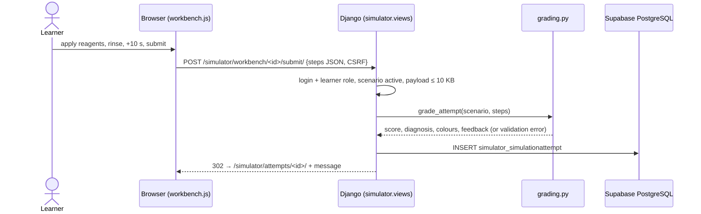
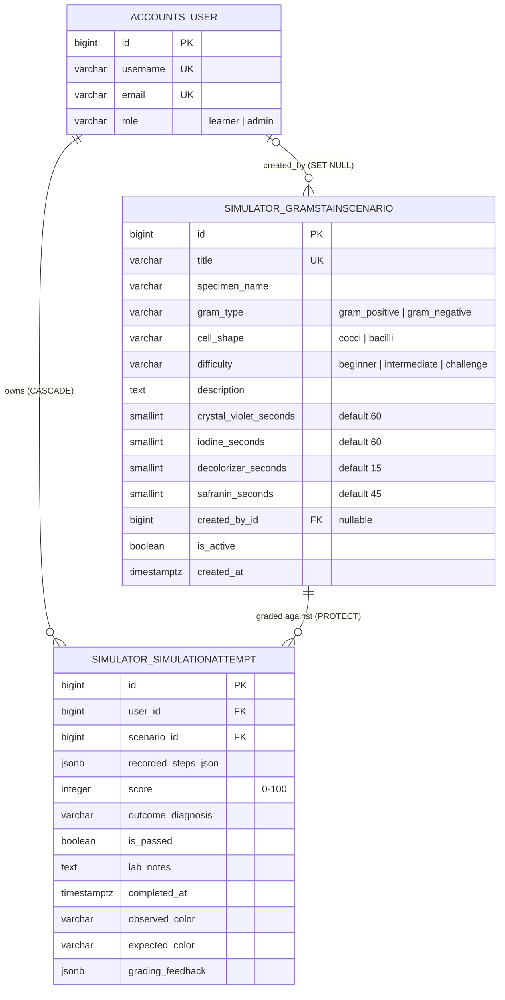
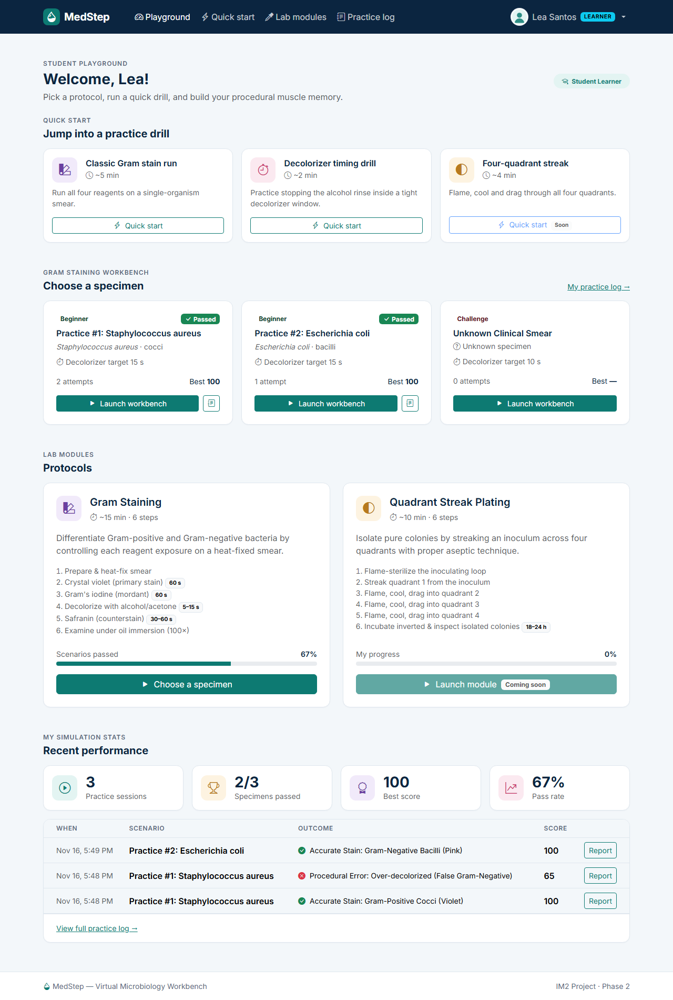
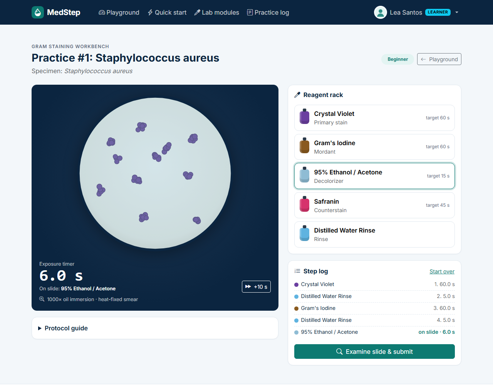
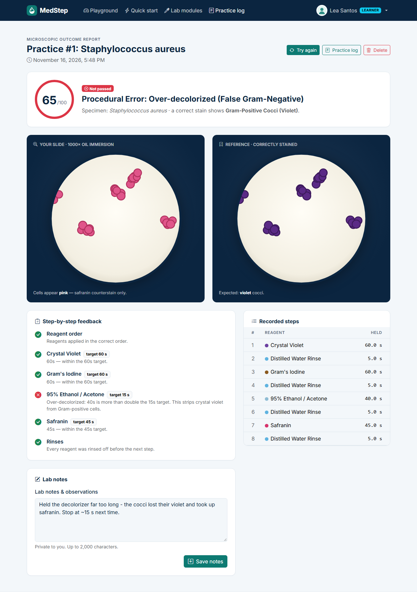
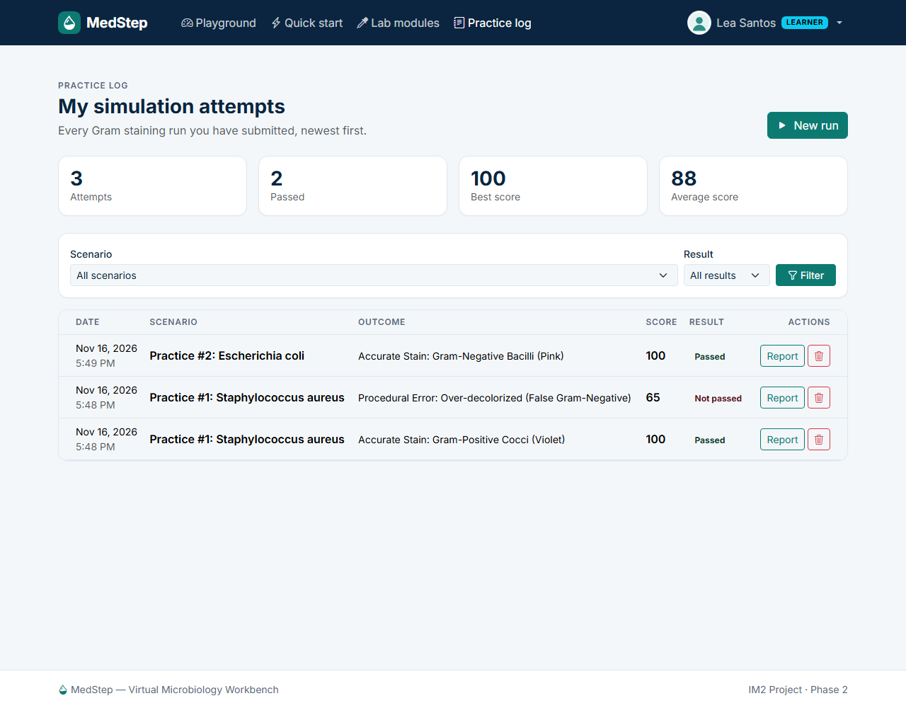
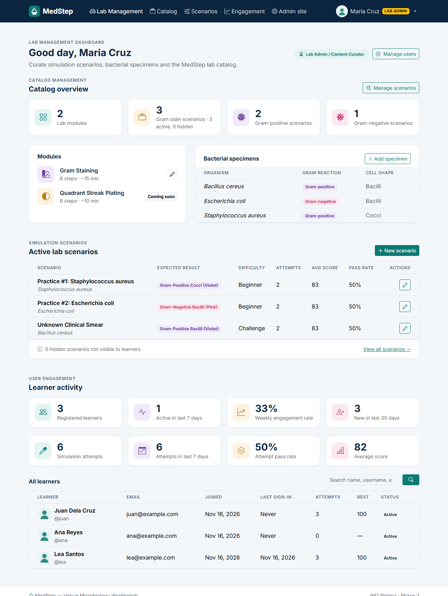
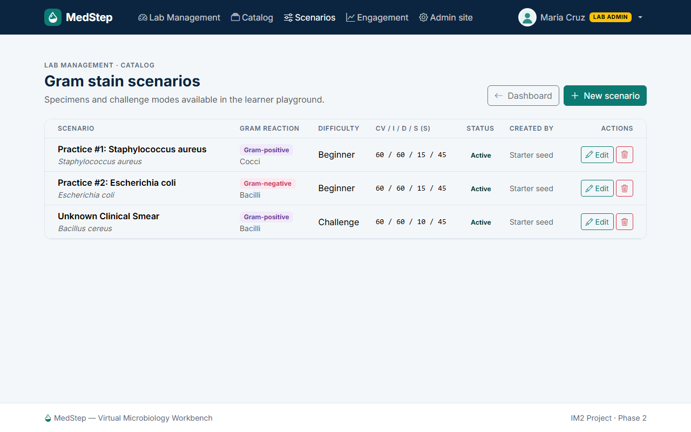
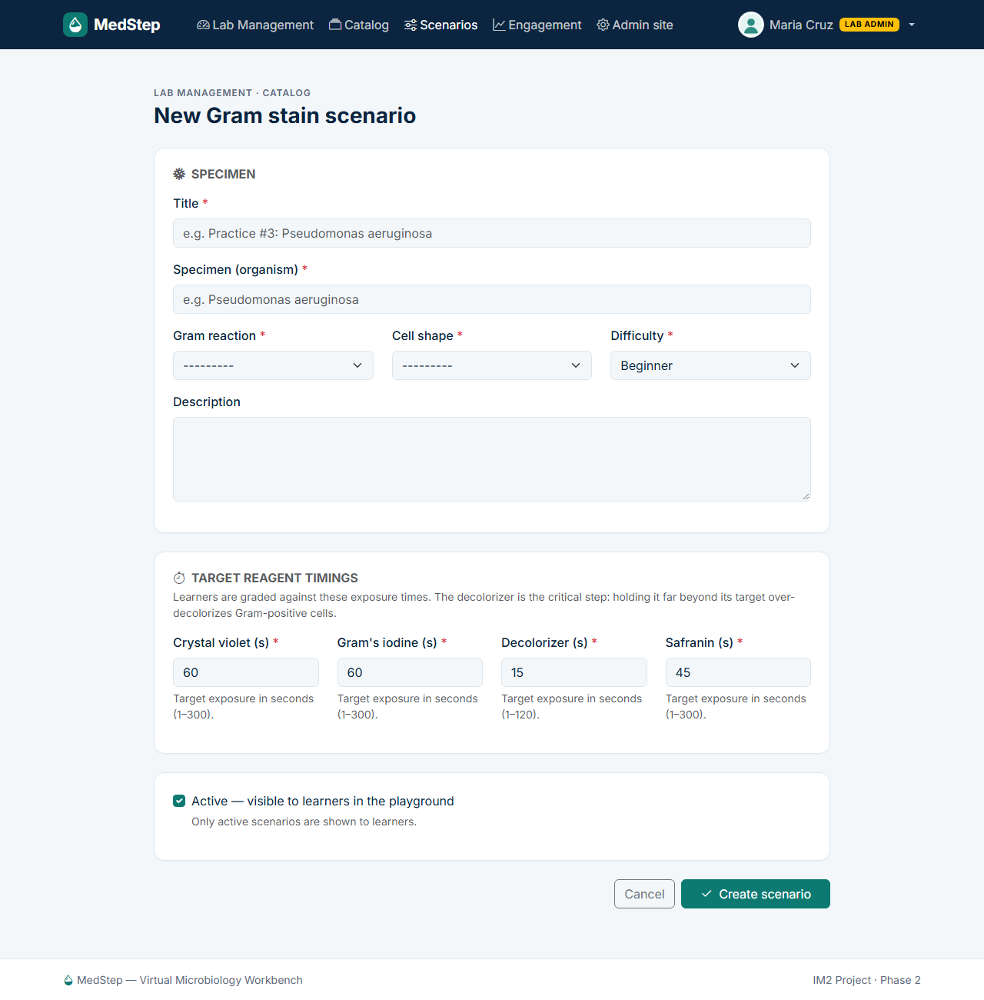

# MedStep — PD2 Completion Report

**Course:** IM2 — Information Management 2 · Project Development 2
**Group:** G2 — *[member names]*
**Repository:** https://github.com/x1ren/MedStep-Anoos-Iben-G2
**Date:** November 16, 2026

---

## 1. Summary

MedStep is a Django + Supabase (PostgreSQL) web laboratory simulator that lets
allied health students practise microbiology protocols without consumables or
a booked lab. PD1 delivered the account foundation (two roles, authentication,
role-based dashboards, profiles). **PD2 delivers a complete vertical slice of
the Gram Staining Simulator**: a database-backed scenario catalog managed by
Lab Admins, an interactive workbench where learners stain a virtual smear in
real time, a server-side grading engine, and full CRUD over each learner's own
practice records — all on top of the PD1 roles and access control, which
remain intact.

| | |
|---|---|
| New Django app | `simulator` |
| New tables | `simulator_gramstainscenario`, `simulator_simulationattempt` |
| New migrations | `simulator` 0001–0004 (0002 seeds the starter specimens) |
| New pages | 7 (scenario list, form, delete; workbench; outcome report; practice log; attempt delete) + 2 updated dashboards |
| Automated tests | **261 passing** (138 new in `simulator`) |

---

## 2. Requirements checklist

| PD2 requirement | Status | Where |
|---|---|---|
| `GramStainScenario` model (title, specimen, Gram type, cell shape, difficulty, description, 4 reagent timings, `created_by`, `is_active`, `created_at`) | ✅ | `simulator/models.py` |
| `SimulationAttempt` model (user, scenario, `recorded_steps_json`, score, diagnosis, `is_passed`, `lab_notes`, `completed_at`) | ✅ | `simulator/models.py` |
| Seed data for 3 starter specimens | ✅ | `simulator/migrations/0002_seed_starter_scenarios.py` |
| Lab Admin: full CRUD of scenarios, reachable from `/dashboard/admin/` | ✅ | `/simulator/scenarios/…` |
| Learner **Read**: browse active modules on `/dashboard/learner/`, view own reports | ✅ | Student Playground, `/simulator/attempts/<id>/` |
| Learner **Create**: run the workbench and save the attempt to Supabase | ✅ | `/simulator/workbench/<id>/` → `…/submit/` |
| Learner **Update**: edit lab notes on own attempts | ✅ | `/simulator/attempts/<id>/notes/` |
| Learner **Delete**: delete own attempts with confirmation | ✅ | `/simulator/attempts/<id>/delete/` |
| All routes require login; learners only touch their own attempts; only admins manage scenarios | ✅ | §7 |
| Django `messages` on every action | ✅ | §7 |
| Workbench: microscope slide with cocci / bacilli, live colour change, liquid wash overlay | ✅ | §6 |
| Five reagent controls (crystal violet, iodine, decolorizer, safranin, water rinse) | ✅ | §6 |
| Live timer + `+10 s` fast-forward | ✅ | §6 |
| Outcome report: backend grading of order and timing, saved to Supabase, high-magnification result, step feedback, editable notes | ✅ | §5, §8 |
| Git: stable `main`, `develop`, ≥ 2 feature branches (not deleted) | ✅ | §10 |
| README + `docs/` completion report | ✅ | `README.md`, this file |

---

## 3. System overview

| Role | Can do |
|---|---|
| **Student Learner** (`learner`, default on registration) | Browse active specimens, run the workbench, read / annotate / delete **own** attempts, view own stats |
| **Lab Admin / Content Curator** (`admin`) | Create / read / update / hide / delete Gram stain scenarios, view catalog and engagement metrics |

How a run becomes a saved record:



---

## 4. Database design



**Integrity rules enforced by PostgreSQL** (not only by forms):

| Rule | Implementation |
|---|---|
| Scenario titles are unique | `UNIQUE (title)`; forms also reject case-insensitive duplicates |
| Only valid Gram types / cell shapes | `CHECK gram_scenario_valid_gram_type`, `CHECK gram_scenario_valid_cell_shape` |
| Reagent timings are positive | `CHECK gram_scenario_positive_timings` (forms also cap at 300 s / 120 s) |
| Score is 0–100 | `CHECK score >= 0` (positive integer) and `CHECK attempt_score_max_100` |
| Stored colours are valid | `CHECK attempt_valid_colors` |
| A scenario with attempts cannot be deleted | `on_delete=PROTECT` — learners never lose history; admins hide it instead |
| Deleting an admin keeps their scenarios | `created_by … on_delete=SET_NULL` |
| Deleting a user removes their own attempts | `user … on_delete=CASCADE` |
| Fast "my latest attempts" queries | composite index `attempt_user_recent_idx (user_id, completed_at DESC)` |

**Design decision — grading snapshot.** Besides the required fields,
`SimulationAttempt` stores `observed_color`, `expected_color` and
`grading_feedback` captured at grading time. A completed attempt is a
historical record: if an admin later changes a scenario's target timings, old
reports must still show what was graded then. (A test edits the scenario after
grading and confirms the report is unchanged.)

**Seed data** (`0002_seed_starter_scenarios`, idempotent and reversible):

| Title | Specimen | Gram | Shape | Difficulty | Decolorizer target |
|---|---|---|---|---|---|
| Practice #1: Staphylococcus aureus | *S. aureus* | positive | cocci | beginner | 15 s |
| Practice #2: Escherichia coli | *E. coli* | negative | bacilli | beginner | 15 s |
| Unknown Clinical Smear | *Bacillus cereus* | positive | bacilli | challenge | 10 s |

---

## 5. Grading engine

`simulator/grading.py` is pure Python (no database or HTTP), so it is easy to
unit-test. It has two parts.

**Chemistry simulation.** The submitted steps are replayed on the specimen's
cell wall to find the final cell colour:

- Effective crystal violet stains cells violet; iodine (after crystal violet)
  locks it in as a complex.
- **Gram-positive** cells keep the complex unless decolorizer exposure exceeds
  **2 × the target** → over-decolorized, cells turn pink after safranin.
- **Gram-negative** cells (or Gram-positives without iodine) lose crystal violet
  once decolorizer exposure reaches **⅓ of the target**; below that they stay
  violet → under-decolorized.
- Decolorizer also strips any safranin already applied; without safranin,
  washed-out cells are colourless.
- A stain or mordant held for less than ¼ of its target does not take.

**Scoring** (starts at 100, clamped to 0–100):

| Issue | Deduction |
|---|---|
| Reagent never applied | −25 |
| Reagents out of order | −20 |
| Final colour wrong for the specimen | −20 |
| Decolorizer far outside its window | −15 |
| Other reagent far from target (< ½ or > 2×) | −10 |
| Any reagent slightly off target | −5 |
| Reagent not rinsed with water before the next step | −3 each |

**Pass** = correct colour **and** all four reagents applied effectively in
order **and** score ≥ 70.

**Diagnoses** (stored in `outcome_diagnosis`):

| Situation | Diagnosis |
|---|---|
| Correct technique | `Accurate Stain: Gram-Positive Cocci (Violet)` (etc.) |
| Gram-positive, decolorizer > 2× target | `Procedural Error: Over-decolorized (False Gram-Negative)` |
| Gram-negative, decolorizer < ⅓ target | `Procedural Error: Under-decolorized (False Gram-Positive)` |
| Iodine skipped on a Gram-positive | `Procedural Error: Mordant Omitted (False Gram-Negative)` |
| Decolorizer skipped on a Gram-negative | `Procedural Error: Decolorizer Omitted (False Gram-Positive)` |
| Safranin skipped on a Gram-negative | `Procedural Error: Counterstain Omitted (Cells Colorless)` |
| Right colour but a step skipped | `Incomplete Protocol: Safranin Omitted` (etc.) |
| No crystal violet | `Procedural Error: Primary Stain Omitted (Uninterpretable Smear)` |
| Wrong order | `Procedural Error: Reagents Out of Order` |

Teaching detail: over-decolorizing *E. coli* still passes (85/100) because
Gram-negative cells are pink either way — but the feedback warns that the same
timing would have ruined a Gram-positive smear.

**Input validation.** Each step must be a known reagent with 0 < seconds ≤ 900;
at most 50 steps; payload ≤ 10 KB; malformed input is rejected with a message
and nothing is saved.

---

## 6. Interactive workbench

Pure Django template + SVG + vanilla JavaScript (no frameworks, no build step).

- **Microscope field** (`templates/simulator/_slide.html`, `simulator/slide.py`):
  grape-like clusters of cocci or scattered rods, generated from the scenario
  id so each scenario always shows the same field.
- **Reagent rack**: Crystal Violet, Gram's Iodine, 95% Ethanol / Acetone,
  Safranin, Distilled Water Rinse — each shows its role and target time.
- **Live exposure timer** for the reagent on the slide, plus **+10 s
  fast-forward** for quick tests and live demos.
- **Live colour**: cells fade between unstained → violet → colourless / pink as
  the timer runs; the pooled reagent tints the slide and washes away on rinse.
- **Step log** with running time, **Start over**, and a leave-page warning for
  unsubmitted runs; the bench locks on submit to prevent double posting.
- **Challenge mode** hides the organism's name until the report.

`static/js/stain-chemistry.js` is a browser copy of the Python chemistry used
only for live feedback; the server always re-grades. An automated test runs
the JavaScript in Node.js against the Python grader on **744 cases** to prove
they agree.

---

## 7. CRUD and access control

| Entity | Operation | Learner | Lab Admin | Anonymous |
|---|---|---|---|---|
| Gram stain scenario | Create / Update / Delete | 403 | ✅ | → login |
| Gram stain scenario | Read (catalog list) | 403 | ✅ | → login |
| Gram stain scenario | Read (active, in playground / workbench) | ✅ | 403 | → login |
| Simulation attempt | Create (submit run) | ✅ own | 403 | → login |
| Simulation attempt | Read (report, practice log) | ✅ own only — others' → **404** | 403 | → login |
| Simulation attempt | Update (lab notes only) | ✅ own only — others' → **404** | 403 | → login |
| Simulation attempt | Delete (with confirmation) | ✅ own only — others' → **404** | 403 | → login |

- Every view is wrapped by `@learner_required`, `@lab_admin_required` or
  `RoleRequiredMixin`, which include `login_required`.
- Attempts are always queried through `own_attempts(request.user)`, so another
  learner's attempt id returns 404 rather than revealing that it exists.
- The browser can never set the owner, score, diagnosis or pass/fail; extra
  POST fields are ignored (covered by tests).
- Data changes use POST with CSRF tokens; deletes need a confirmation page.

**Messages shown to users**

| Action | Message |
|---|---|
| Scenario created / updated / deleted | `Scenario "…" was created / updated / deleted.` |
| Scenario delete blocked | `"…" has N saved learner attempts and cannot be deleted. Untick "Active" to hide it…` |
| Invalid scenario form | `The scenario was not saved. Please fix the highlighted errors.` |
| Run passed / failed | `Attempt saved and passed — <diagnosis> · <score>/100.` / `Attempt saved but not passed — …` |
| Run rejected | `Your run could not be graded: <reason>. Please try again.` / `Your run could not be read…` |
| Notes saved / invalid | `Lab notes saved.` / `Your lab notes were not saved. Please fix the error below.` |
| Attempt deleted | `Your "<scenario>" attempt from <date> was deleted.` |

---

## 8. User interface

**Student Playground** — quick starts, specimens with launch buttons and personal
best scores, real stats and recent attempts.



**Workbench mid-run** — decolorizer on the slide at 6.0 s; Gram-positive cocci
still violet.



**Microscopic outcome report** — an over-decolorized *S. aureus* run: the
learner's slide (pink) beside the correctly stained reference (violet),
step-by-step feedback, recorded steps and editable lab notes.



**Practice log** — filters by scenario and result, pagination, report and delete
actions.



**Lab Management dashboard** — live catalog counts, per-scenario attempts,
average score and pass rate, and per-learner activity.



**Scenario management** — list and create/edit form.





---

## 9. Testing

Run: `python manage.py test --keepdb`

| Area | Tests |
|---|---|
| Accounts (PD1): models, registration, login/logout, access control, profile, navbar, password, role migration | 82 |
| Dashboards (learner & Lab Admin, incl. live attempt metrics) | 38 |
| Landing page | 3 |
| Simulator — models & seed data | 24 |
| Simulator — scenario CRUD & access | 24 |
| Simulator — grading engine | 28 |
| Simulator — workbench page & slide builder | 12 |
| Simulator — JS ↔ Python chemistry parity (Node.js) | 3 |
| Simulator — submit / create attempt | 19 |
| Simulator — outcome report & lab notes | 13 |
| Simulator — practice log & delete | 15 |
| **Total** | **261** |

Highlights: every role/ownership rule in §7 has a test (including forged POST
fields and guessed ids); the grading engine is tested for every diagnosis,
boundary and malformed input; reports are proven to use the grading snapshot.

**End-to-end check.** The real workbench page was driven in headless Microsoft
Edge: the JavaScript ran complete staining protocols, submitted them with the
page's CSRF token, and the server graded, saved and redirected to the report —
a textbook *S. aureus* run (100, violet), an over-decolorized run (65, pink)
and a textbook *E. coli* run (100, pink). The screenshots in §8 were captured
the same way.

---

## 10. Git workflow

```
main ──────────────●────────────────────────────────────────●   (stable releases)
                    \                                        /
develop              ●────────────●──────────────────────────●  (integration, --no-ff merges)
                      \          / \                        /
feature/gram-stain-catalog   ●──●    \                      /
                                       ●──●──●──●──●──────●
                              feature/gram-stain-workbench
```

- `develop` was created from a stable `main` (end of PD1).
- `feature/gram-stain-catalog`: simulator app & `GramStainScenario`, seed data,
  Lab Admin list/create/edit, delete with confirmation, admin-dashboard
  integration → merged into `develop` with `--no-ff`.
- `feature/gram-stain-workbench`: `SimulationAttempt`, grading engine, workbench
  page, workbench JavaScript, then attempt saving, outcome report, practice log,
  dashboards and this documentation → merged into `develop`, then `develop`
  into `main`.
- Feature branches are kept after merging, as required.

---

## 11. Limitations and next steps

- **Quadrant Streak Plating** is described in the catalog but its simulator is
  not built yet (shown as "Coming soon").
- For live colouring, the workbench page includes the specimen's Gram reaction
  in its JavaScript configuration, so a determined learner could read it from
  the page source on the "Unknown" challenge. Grading is unaffected; a future
  version could fetch colours from the server per step instead.
- Module descriptions and quick-start cards are still static data
  (`dashboard/catalog.py`); only Gram stain scenarios are database-managed.
- Submissions are limited to one saved attempt per scenario every
  `ATTEMPT_COOLDOWN_SECONDS` (default 10 s), which stops duplicates; there is
  no wider per-IP rate limiting yet.

---

## 12. Setup

See [README.md](../README.md) for installation, Supabase configuration, the URL
map and how to run the tests. After pulling PD2, run
`python manage.py migrate` to create the simulator tables and seed the starter
specimens.
